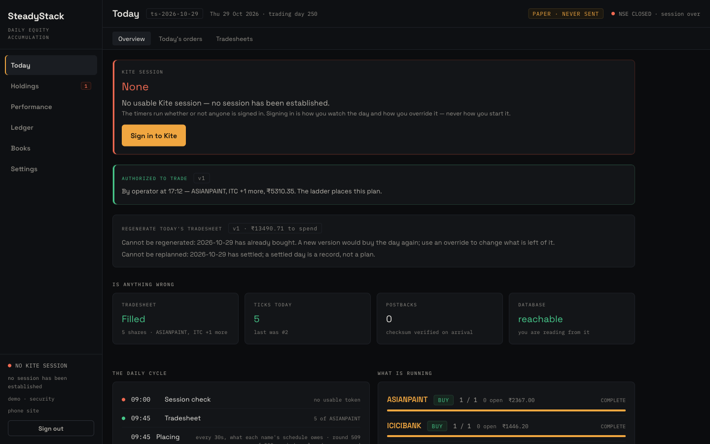
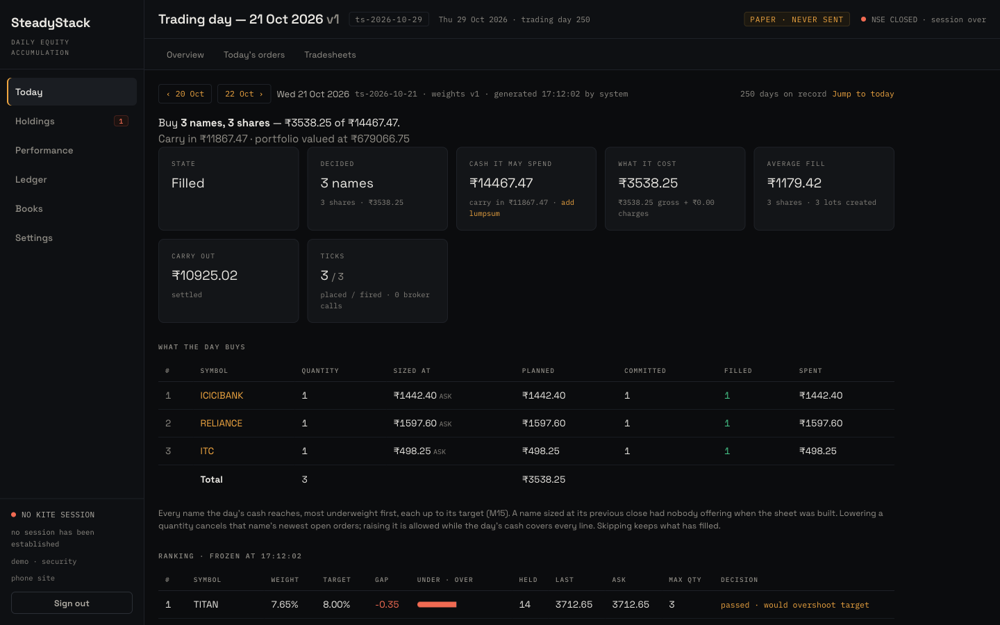
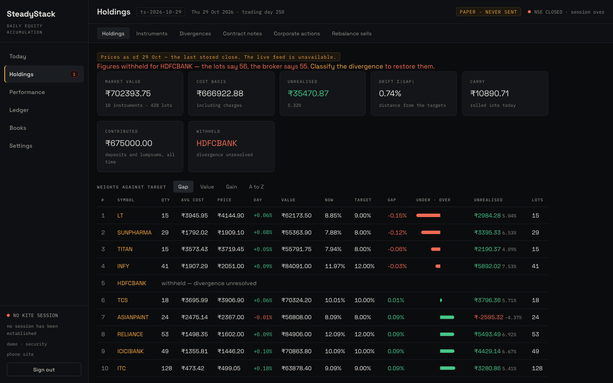
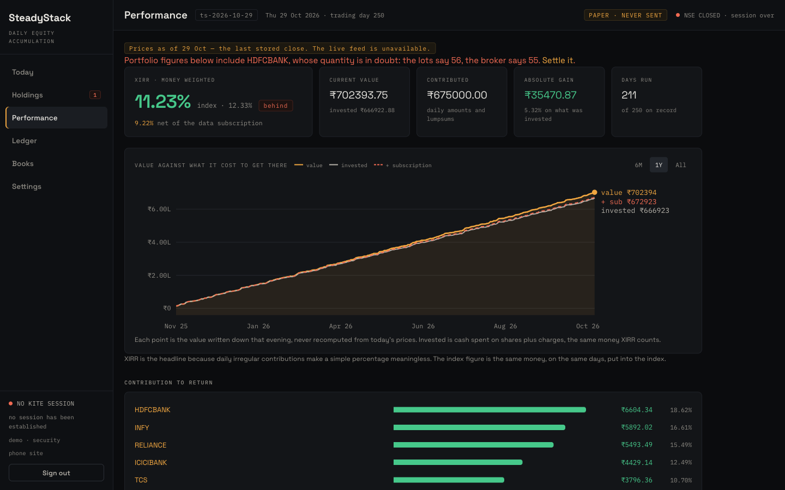
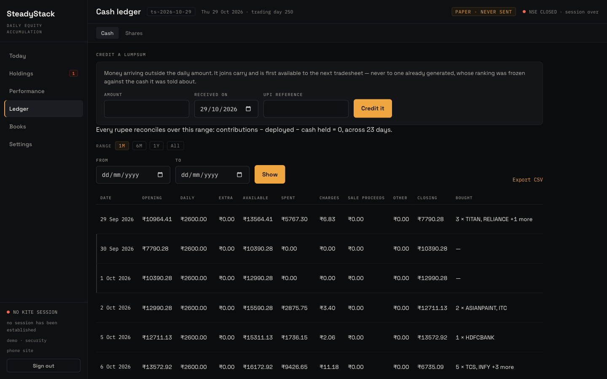
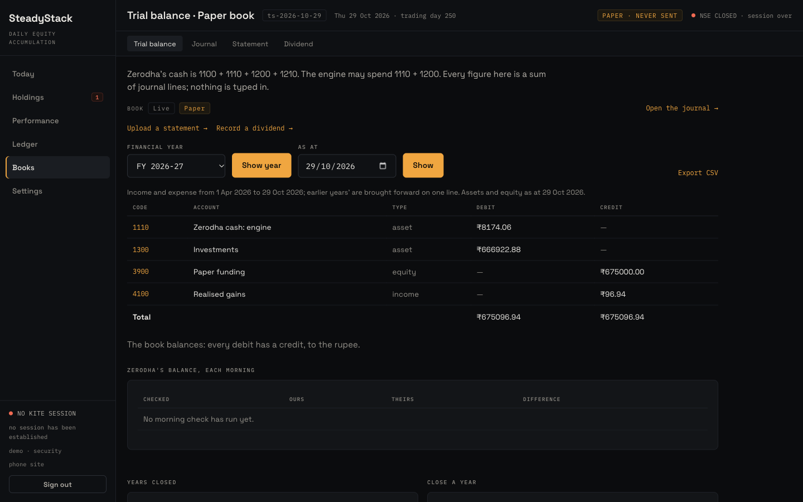
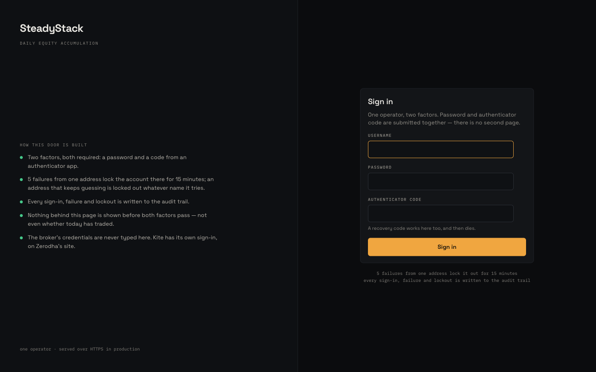
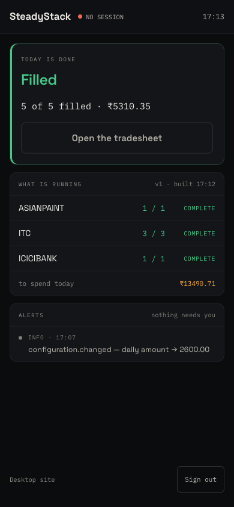

# SteadyStack

A long-horizon equity accumulation system. Every trading day it invests a fixed
rupee amount — plus anything carried over, plus any lumpsum — into Indian
stocks through the Zerodha Kite Connect API, against a model portfolio of
target weights.

It was built to accumulate a portfolio for a child over decades, so it favours
durability over cleverness: cheap to run, boring to operate, and auditable
years after any given trade. A portfolio held for a child still runs in an
adult's demat account here, because Zerodha does not issue Kite Connect API
access on minor accounts.

> **Status:** Phases 1–3 are built and run in **paper mode** — every order is
> recorded exactly as a live one and filled against the live tick feed, but
> never sent. Live trading is refused unless a registered static IP is recorded
> and matches (Phase 4: the box, the address, the first live order).

> **Use at your own risk.** This software places real orders with real money
> when run live. It is provided as is, with no warranty, and the authors and
> contributors accept no liability for anything that results from using it.
> It is not investment advice. Read the [Disclaimer](#disclaimer) before you
> connect it to a broker account.

## Features

**Planning the day**
- Ranks a model portfolio by *gap* — current weight minus target — and buys
  every name the day's cash reaches, most underweight first, each up to its
  target.
- Spends a fixed daily amount plus *carry* (yesterday's unspent cash) plus
  any lumpsum; an expensive name waits until the carry can reach it.
- Every plan is a versioned, frozen *tradesheet*: the ranking, the prices it
  saw, and the cash it may spend.
- Nothing is placed until a person authorizes that version. Regenerate before
  the first order; once the day has bought, stop it and *replan* net of what
  it already filled.

**Placing orders**
- A *ladder* of limit orders, one thirty-second round at a time: each name
  keeps to an even schedule across the window, at the bid while on schedule
  and stepping toward the ask as it falls behind.
- At most five orders per thirty seconds across the system, most-behind name
  first. Orders are never modified; a stale one is cancelled and replaced.
- From 15:00 the close cancels what rests and buys each remainder at market,
  paced to 15:25, with market protection and a price-drift guard.
- Operator overrides — change a quantity, skip a name or the day, exclude a
  round, stop trading — each one audited.
- Rebalance sells from a CSV upload, sold on the same rounds, with the
  proceeds reinvested the next day.

**Safety rails**
- **Paper by default.** A paper order is recorded exactly as a live one and
  filled against the live tick feed, but never sent.
- Live trading is refused unless a registered static IP matches the address
  the system is calling from, and refused before any broker call.
- Scheduled tasks are idempotent: a round that runs twice is rejected, not
  repeated.
- Every broker call is stored with its request, response and latency,
  credentials redacted; every log line, audit event and call for a day shares
  one trace ID.

**Keeping the books**
- A double-entry journal: every movement of money is a balanced, append-only
  entry, enforced by the database. Mistakes are reversed, never edited, and a
  closed financial year accepts nothing new.
- FIFO lots, immutable once consumed, with a realised-gain row for each sale.
- Reconciliation against the broker — holdings, positions, trades and the
  monthly funds statement — with every divergence classified, not hidden.
- Contract notes, dividends, corporate actions, and a morning balance check.

**Reporting**
- XIRR against a benchmark index, net of the data subscription.
- A daily value series, contribution to return, and drift from targets.
- Cash and share ledgers that reconcile to the rupee, with CSV export.

**Running it**
- Server-rendered Django pages, plus five phone screens for the morning
  check and authorization.
- Username, password and TOTP sign-in, with recovery codes and lockouts.
- `preflight` reports everything that would stop a trading day.
- Terraform for a single EC2 box, with systemd timers driving the schedule
  and nightly backups.

## Screens

Taken from a development database filled by `manage.py seed_demo` — a paper
book, ten instruments, 250 trading days. None of it is a real account.

| | |
|---|---|
| **Today** — the day's plan, whether it is authorized, and what is running<br> | **A trading day** — what the cash reached, what it cost, and the frozen ranking<br> |
| **Holdings** — every name against its target weight, with FIFO lots behind it<br> | **Performance** — XIRR against the index, value against what it cost<br> |
| **Cash ledger** — every rupee from contribution to fill, reconciled daily<br> | **Books** — a balanced double-entry trial balance, live and paper kept apart<br> |
| **Sign-in** — password and authenticator code, together<br> | **Phone** — five screens under `/m/` for the morning check<br> |

## How a day works

1. **09:00** — check there is a usable Kite session.
2. **09:45** — plan the day: rank the model portfolio by how far each name is
   below its target, then walk the ranking and buy **every name the day's cash
   reaches**, each up to its target weight. A name nobody is offering is sized
   at its previous close. The plan is stored as a versioned **tradesheet**.
3. **Authorize** — nothing is placed until a person authorizes that version of
   the tradesheet. Regenerating makes a new version that needs authorizing
   again.
4. **Placing rounds** — every thirty seconds, each name places what its even
   schedule across the day owes: at the bid while it keeps up, stepping toward
   the ask as it falls behind. At most five orders per thirty seconds across
   every name, most-behind first. Orders are never modified; one that rests
   unfilled too long is cancelled and placed again at the current price.
5. **15:00–15:25** — what still rests is cancelled and each name's remainder
   is bought at market in rounds across the close, unless its price has moved
   too far from the plan. Every market order carries market protection.
6. **15:45** — reconcile with the broker, settle the day's ledger row, carry
   the unspent cash forward, and value the portfolio.

The operator can change one name's quantity, skip a name or the whole day,
exclude a tick, regenerate the plan until the first order is out, credit a
lumpsum, and upload rebalance sells — every change audited.

The full specification is `docs/superpowers/specs/2026-09-21-steadystack-prd.md`.
Conventions for working in the code are in `CLAUDE.md`.

| Guide | For |
|---|---|
| [`SETUP.md`](SETUP.md) | Local development, in detail, and application setup on the production box |
| [`DEPLOY.md`](DEPLOY.md) | Provisioning AWS with Terraform, first boot, shipping code, going live — and the gaps to close first |
| [`OPERATIONS.md`](OPERATIONS.md) | The trading day, the operator's routine, commands, logs, alarms, stop/resume, backups and restore |

## Stack

- Python 3.12+, Django (server-rendered, no SPA), managed with
  [uv](https://docs.astral.sh/uv/)
- PostgreSQL 16 — two roles: a restricted runtime role and the schema owner
- Tailwind CSS v4, built by the CLI; the built `app.css` is committed
- Kite Connect (`kiteconnect`) for quotes, depth, orders and the tick feed
- Sign-in is username + password + TOTP

## Set up locally

### 1. Prerequisites

- Python 3.12+ and `uv`
- Docker (for Postgres), or a local PostgreSQL 16
- Node.js — only if you change template classes and need to rebuild the CSS
- A Kite Connect app (API key and secret) with the market-data subscription,
  whose redirect URL is `http://127.0.0.1:8000/broker/kite/callback/`

### 2. Clone and install

```sh
git clone https://github.com/GreyBoxed/steadystack.git
cd steadystack
uv sync
git config core.hooksPath .githooks   # commit-message and credential checks
```

### 3. Start Postgres

```sh
docker compose up -d
```

This starts Postgres 16 on `localhost:5432` and runs
`ops/postgres/init/01-roles.sql`, which creates the schema owner
(`steadystack_owner`) and the restricted runtime role (`steadystack_app`).

### 4. Configure

```sh
cp .env.example .env
```

Fill in `.env`:

| Variable | What it is |
|---|---|
| `DJANGO_SECRET_KEY` | Any long random string for local use |
| `DATABASE_URL` | Runtime role (defaults work with the Docker setup) |
| `DATABASE_MIGRATION_URL` | Schema owner, used by `migrate` |
| `KITE_API_KEY`, `KITE_API_SECRET` | From your Kite Connect app |
| `KITE_TOKEN_KEY` | A Fernet key; generate one with the command in `.env.example` |

`.env` is git-ignored. Never commit it — a leaked Kite key or TOTP seed is
fixed by rotating it, not by deleting the commit.

### 5. Create the database and your sign-in

```sh
uv run python manage.py migrate
uv run python manage.py createsuperuser        # your username and password
uv run python manage.py enrol_totp <username>  # prints a QR code for your authenticator app
```

`enrol_totp` also prints ten one-time recovery codes. Keep them somewhere other
than this machine.

### 6. Load the reference data

```sh
uv run python manage.py load_calendar ops/calendar/nse-2026.csv   # NSE sessions
uv run python manage.py runserver
```

Then, in the browser at <http://127.0.0.1:8000>:

1. Sign in with your password and authenticator code.
2. **Settings → Kite session → Connect** — log in at Zerodha; the token comes
   back encrypted and lasts until the next morning.
3. **Holdings → Instruments** fills itself once you run
   `uv run python manage.py refresh_instruments` (needs the Kite session).
4. **Settings → Model portfolio** — upload a CSV of `symbol,target_pct`
   (weights summing to 100); `ops/model-portfolio/` has an example. Review the
   diff, then store it.
5. If you already hold shares, import them once with
   `uv run python manage.py import_opening_positions <csv> --actor <you>`.

`runserver` prints the state of the installation before it serves — database,
migrations, order mode, Kite session, model portfolio, calendar — with anything
that would stop a trading day listed first. `manage.py preflight` prints the
same report on its own.

### Just want to look around?

```sh
uv run python manage.py seed_demo --reset
```

fills a **development** database with a believable history through the real
code paths (it refuses unless `DEBUG` is on and the mode is paper). It
recreates the schema, so don't run it against data you want to keep.

## What has to be running

On a laptop, four things run side by side through the trading day:

| Process | Start it with | Runs | If it is not running |
|---|---|---|---|
| Postgres | `docker compose up -d` | Always | Nothing works |
| Web app | `uv run python manage.py runserver` | Whenever you want the browser | No browser: no Kite login, no authorizing. The day itself carries on from the terminal |
| Tick feed | `uv run python manage.py run_ticker` | Market hours, all day | **Paper orders never fill.** Orders rest, go stale and are replaced; the close then buys everything at market |
| The day | `./ops/local/run_day.sh --watch` | From before 09:45 until it settles after the close (it waits through 14:00–15:00 on its own) | **Nothing is placed.** No rounds, no close, no settlement |

Start the day loop any time: a day already placing keeps its plan and carries
on from where the clock is. Ctrl-C is safe — every round is claimed in the
database before it acts — and restarting picks up at the next round.

In production none of this is run by hand. systemd does it:
`steadystack-web` (gunicorn) and `steadystack-ticker` are long-running services;
`session-check`, `tradesheet`, `ladder`, `fallback`, `eod` and `backup` are
timers. See [`OPERATIONS.md` §1](OPERATIONS.md#1-the-trading-day).

## Run a trading day locally

There is no scheduler on a laptop, so a day is run by hand. You need a Kite
session, and planning today is only allowed while the market is open
(09:15–15:30 IST).

**Terminal 1 — the tick feed** (fills paper orders against live prices):

```sh
uv run python manage.py run_ticker
```

**Terminal 2 — the day:**

```sh
./ops/local/run_day.sh            # preflight, session check, plan, authorize prompt, one round
./ops/local/run_day.sh --watch    # a round every 30s to 14:00, the close's rounds from 15:00
./ops/local/run_day.sh --settle   # one close round, settle the ledger, value the portfolio
```

The same steps from the browser, on **Today**:

- **Generate today's tradesheet** — when the day has no plan yet
- **Authorize** — the ladder places nothing until you do
- **Regenerate** — replan from fresh prices until the first order is out
  (for example after crediting a lumpsum on **Ledger → Cash**)

Or one command at a time:

```sh
uv run python manage.py generate_tradesheet
uv run python manage.py authorize_tradesheet --actor <you>
uv run python manage.py ladder_tick           # one placing round; its number comes from the clock
uv run python manage.py market_fallback       # one round of the close
uv run python manage.py settle_day
uv run python manage.py snapshot_valuation
```

A day cannot be compressed: each round's number comes from the wall clock, and
a round that already ran is refused rather than repeated.

## Tests and checks

```sh
uv run pytest                  # the whole suite; needs Postgres running
uv run ruff check src && uv run ruff format --check src
npm install && npm run build   # only after changing template classes
```

Tests run against a throwaway `test_steadystack` database. Only one test run at a
time: two runs share that database and trip over each other.

## Layout

| Path | What lives there |
|---|---|
| `src/engine/` | Tradesheets: ranking, selection, the reserve, planning, authorization, the cash ledger |
| `src/orders/` | The ladder, placement, the 15:00 fallback, overrides, postbacks, the tick feed |
| `src/broker/` | The Kite client, the daily session, paper mode, the live-order gate |
| `src/portfolio/`, `src/gains/` | Instruments, holdings, FIFO lots, realised gains |
| `src/performance/` | Every reported number: valuation, XIRR, the value series, the ledgers |
| `src/web/` | The pages and the charts (inline SVG, drawn from server-side geometry) |
| `src/rebalance/`, `src/records/` | Rebalance sells; divergences, contract notes, corporate actions |
| `docs/` | The PRD, the phase plans, and the design snapshot of the screens |
| `ops/` | Postgres roles, the NSE calendar, an example model portfolio, the local day script |

## Commits

Conventional Commits, validated by `.githooks/commit-msg`; the pre-commit hook
scans for credentials and runs ruff on staged Python. Scopes and domain
vocabulary are listed in `CLAUDE.md`.

## Disclaimer

**This software is provided "as is", without warranty of any kind**, express
or implied, including fitness for a particular purpose, accuracy, or
availability. By using it you accept the following:

- **No liability.** The authors, copyright holders and contributors are not
  liable for any loss or damage of any kind — trading losses, missed or
  duplicated orders, wrong quantities or prices, broker or exchange charges,
  penalties, tax consequences, data loss, or anything else — however it
  arises, whether from a bug, a misconfiguration, a broker or market-data
  failure, or the software working as designed. Sections 7 and 8 of the
  [LICENSE](LICENSE) set this out in full.
- **Not advice.** Nothing here is investment, financial, tax or legal
  advice, or a recommendation to buy or sell any security. The model
  portfolios, weights, screenshots and examples in this repository are
  illustrations only.
- **You are the operator.** You decide whether to run it, against which
  account, with what configuration and how much money. Every order it places
  is your order, and you are solely responsible for it and for checking what
  it did.
- **Your compliance.** Meeting SEBI regulations, your broker's terms for API
  and automated trading, exchange rules, and tax and reporting obligations is
  your responsibility alone.
- **Test first.** Run in paper mode, read the code, and understand what it
  will do before you let it place a live order. Past behaviour in paper mode
  says nothing certain about live results.

If you do not accept these terms, do not use the software.

## License

[Apache License 2.0](LICENSE). Copyright 2026 GreyBoxed; see [NOTICE](NOTICE).

Zerodha and Kite Connect are trademarks of Zerodha Broking Ltd. This project is
not affiliated with, endorsed by, or supported by Zerodha.
