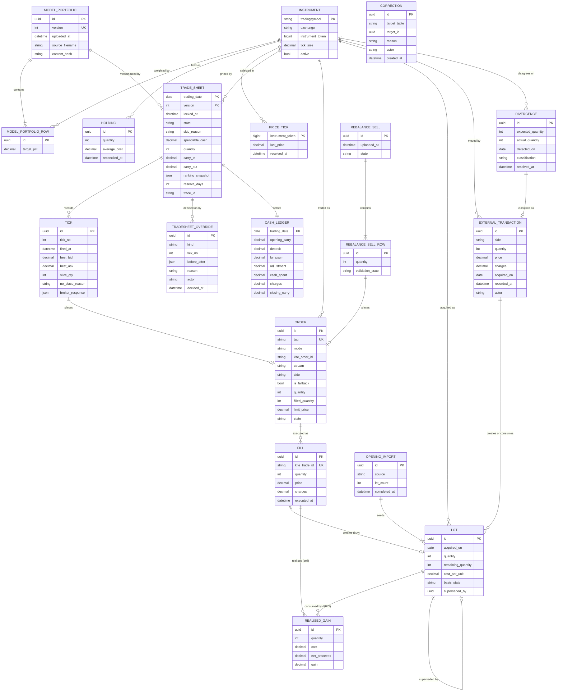

# ✨ steadystack — Daily Equity Accumulation System

## Overview

Build a Django application that invests a fixed rupee amount into Indian
listed stocks every trading day through the Zerodha Kite Connect API, buying
whichever holding is furthest below its target weight, tracking FIFO lots so
realised and unrealised gains are exact. It runs on a single EC2 instance
under systemd timers, with one operator authenticating by password and TOTP.

Four phases: a local prototype running the real Kite client in paper mode,
then infrastructure and the first live order last.

**Origin:** [`docs/superpowers/specs/2026-09-21-steadystack-prd.md`](../superpowers/specs/2026-09-21-steadystack-prd.md).
Requirement IDs (M1–M51, S1–S8, C1–C6) refer to that document's §5.

## Problem statement

Accumulating an equity portfolio for a child over a multi-decade
horizon is mechanically simple and behaviourally hard. Buying ₹1,000 of the
most underweight stock every trading day is a discipline no human sustains for
years. The work is small, repetitive, pinned to a specific minute of the
morning, and unforgiving of the days it gets skipped — which are exactly the
days that compound away.

The system exists to remove discretion, not to add intelligence. It has no
view on markets. It converts a target allocation and a daily budget into
orders, and keeps records good enough that a decision made in 2026 is still
explicable in 2046. That last constraint drives more of this design than the
trading does.

## Corrections to the PRD

A gap analysis of the PRD returned 79 findings. Six changed the specification
rather than refined it. The PRD's revision adopts all six — and rewrote the
execution model besides — so what follows records where each landed. **The PRD
now governs.**

### C1 — The engine could not converge on its targets

The PRD's §1 claim that the system is "self-correcting toward those weights"
was false for any stock priced above roughly one day's budget.

Carry accumulates only on days that do not fill. Under the
substitute-the-next-affordable rule (M15), days almost always fill, so carry
never builds. An expensive stock therefore stays at zero holding, its gap
pinned at −target, permanently at rank 1 and permanently skipped — while the
engine buys rank 2 every day and pushes every *other* holding past its target.
The PRD's own worked example, MRF at ₹142,000, demonstrates the bug.

**Adopted, differently.** M15d stops buying after a run of consecutive
unaffordable days and lets carry build until the leader is reachable; M15c
stops any single day carrying a name past its target on the way. See D5.

### C2 — Money was not conserved

Carry was defined as `cash − (filled_qty × avg_fill_price)` (§6.3), which
ignored brokerage, exchange charges, GST, stamp duty and STT — roughly
₹1.15–1.25 on a ₹1,000 delivery buy, with STT the largest part. The ledger
under-reported spend every single day, making success criterion #2 ("carry
reconciles exactly, no drift") unachievable as written.

**Adopted.** §6.3 now subtracts charges. Two defects in the same formula
remain this plan's to handle rather than the PRD's: `avg_fill_price` is
rounded by the broker and does not reconstruct multi-fill totals, and a day
now places many orders rather than one, so per-order arithmetic misses part of
the spend. See D6.

### C3 — Negative carry had no home

§6.3 said carry "must never be allowed to go negative" and then described it
going negative, with no column on `CashLedger` to hold the difference — so
`closing_carry(t) ≠ opening_carry(t+1)` in an append-only table.

**Adopted.** M40a gives the adjustment its own column and §6.3 posts the
excess against the next day's budget. See D7.

### C4 — Cancel-and-replace could buy twice

M21 instructed falling back to cancel-and-replace whenever a modify was
rejected, and the commonest reason a modify is rejected is that the order just
filled — so the system would cancel a filled order (a no-op) and place a new
order for the original quantity, buying twice.

**Moot.** Orders are never modified (M21), so there is no replace path to
escalate to. The same race survives at the fallback, where a cancel and a fill
can cross, and M22 answers it by confirming every cancellation and re-reading
fills before sizing the market order. See D8.

### C5 — The state machine was two machines, and broken as drawn

§6.5 mixed day-level states with order-level states. As drawn, `REPRICING` had
no exit, `AWAITING_SESSION` could only exit to `PLACED`, `SKIPPED` was a child
of `PLACED`, real broker states had nowhere to live, and sell orders had no
machine at all.

**Adopted.** §6.5 is now two machines — one for the day, one for each order a
tick places — and `REPRICING` is gone with the repricing. D9 restates them as
transition tables and adds the sell side.

### C6 — Scope reductions

- **Nothing tax-specific is built.** No short- or long-term classification, no
  holding-period thresholds or day counts, no rates, no exemption, no
  financial-year reporting, no `TaxConfig` entity. Realised gains are
  economics only: proceeds, cost basis, gain.
  **Adopted.** M12 is withdrawn, M37 stops at the gain, S6 is withdrawn and
  §5.4 puts tax of any kind out of scope. FIFO lots stay — immutable and
  consumed oldest first — because knowing which shares were sold is what
  reconciles this system's records against the broker's.
- **Mutual funds are out.** The PRD now says so itself (§5.4); nothing is
  corrected here any more.
- **Opening position is empty — withdrawn.** The reasoning was that
  `kite.holdings()` returns an average price and never lots, so an imported
  holding could not produce a FIFO-correct realised gain. M35a takes the lots
  from the operator's own records instead, one per original purchase, and
  refuses gains reporting and rebalance sells until the import is marked
  complete. Phase 1.5 builds it.

## Design decisions

### D5 — Reserve and accumulate for unaffordable leaders

When the most underweight instrument costs more than the day's cash, the
engine buys the next affordable underweight name — but not for ever. After a
configurable number of consecutive trading days on which the same name has
ranked first and been unaffordable (M15d, default 5), the day places nothing
and carries its full amount, and keeps doing so until that name can be bought.

```
day 1-5   MRF ranks 1, ltp 142,000 > cash  -> buy the next affordable name
day 6     reserve engages                  -> place nothing, carry in full,
                                              notice raised
day 7..   place nothing, carry accumulates
day n     cash >= MRF ask                  -> buy MRF, capped at target (M15c)
```

The counter is per instrument, resets when the name is bought or stops ranking
first, and the reserve is shown on the tradesheet so that a deliberately idle
day is never read as a failure. The portfolio spends a few days idle in
exchange for the ranking meaning what it says.

The reserve holds no money of its own: carry is the only balance, and money
conservation is unchanged by it. Guards: a name leaving the universe clears
its counter; a name whose price is running away faster than carry accumulates
raises an alert rather than idling the portfolio indefinitely. An earlier
draft of this plan reserved a fraction of each day into a per-instrument
sinking fund, which avoided the idle days at the cost of a second balance
beside carry and a second thing to reconcile; the PRD chose the simpler
mechanism, and the universe is sized knowing it (§12.1).

### D6 — One definition of what a share cost

Nothing tax-specific is built (C6, M35), so there is exactly one cost number:

```
cost = gross + brokerage + exchange charges + GST + stamp duty + STT
```

It drives the cash ledger, carry, lots, realised gain and unrealised gain
alike. Carry is computed by **summing `Fill` rows across every order of the
day** — and a day now places many — never from a broker average price, and
never per-order.

Charges are estimated from a rate card at fill time so the evening can settle
carry, and the lot is marked `basis_estimated`. When the contract note for
that day is available the charges are reconciled against it, the difference is
posted as a cash-ledger adjustment, and the lot moves to `basis_final` (M35b).
Charge components are stored individually (S5), so the basis is exact rather
than estimated and the components stay recoverable if they are ever needed
elsewhere. Nothing is carved out of the basis itself: every charge on the trade
is part of what the shares cost (M35).

### D7 — Carry never goes negative; the overhang has a column

Spend can exceed the cash a day was sized against in two ways: the 15:00
market order fills above the last traded price, or the later slices — priced
up the ladder toward the ask — fill above the price M15 sized against. Carry
is not allowed to go negative. The excess is posted as a negative `adjustment`
on the *next* trading day's ledger row and logged at warning level (§6.3,
M40a), so the append-only identity holds unconditionally, including when the
overhang spans several days:

```
opening_carry + deposit + lumpsum + adjustment − cash_spent − charges
    == closing_carry
```

`spendable_cash = max(0, daily_amount + carry_in + adjustment)`. A lumpsum is
its own appended row, never an update to a closed one, and is spendable from
the *next* tradesheet rather than the one already generated (M8a).

### D8 — Kite is authoritative for order state; postbacks are triggers

A postback is not a payload to apply. It is a signal to take a row lock on the
`Order`, call `order_history()`/`trades()`, and reconcile to **absolute**
values — never to increment. Fills deduplicate on `Fill.kite_trade_id`, which
Kite does provide, rather than on `(order_id, status, timestamp)`, which is
not unique across two genuine partial fills in the same second.

A fill does not stop anything. It reduces that order's unfilled quantity and
with it the day's committed and unfilled totals, so the next tick sizes its
slice against the true remainder rather than a stale one (M27, M21a).

The one cancel-and-replace left in the system is the 15:00 fallback, and it is
sequenced rather than raced (M22): cancel every open order, wait for every
cancellation to be **confirmed**, re-read fills, and only then size the market
order. Sizing from the pre-cancel snapshot over-buys whenever an order fills
in the moments before its cancel lands — C4's defect, moved to the only place
it can still happen.

Authority is split and stated: **Kite is authoritative for order and fill
state; local is authoritative for lots, ledger and carry.**

### D9 — Two state machines, as transition tables

```
TradeSheet:  DRAFT -> AWAITING_SESSION -> RUNNING
                   -> FILLED | PARTIAL | UNFILLED | HALTED | SKIPPED

  PARTIAL:  filled in part at close, or skipped by the operator after a fill
  HALTED:   three consecutive rejections
  SKIPPED:  weekend | holiday | no_session_by_cutoff | reserve_engaged |
            no_affordable_instrument | operator | paused |
            reconciliation_blocked        — before any fill only

Order — one per placing tick, never modified:

  PLACED -> OPEN -> PARTIALLY_FILLED -> COMPLETE | CANCELLED
                 -> COMPLETE | CANCELLED
         -> REJECTED
```

Every `(state, event)` pair is enumerated, including the illegal ones, which
raise. An order is CANCELLED at the fallback or by an operator quantity
reduction (M15b) and never otherwise, and the 15:00 market order runs the same
table — distinguished by its type, not by a state of its own.

Sell orders get their own table, of the same shape and including the fallback:
M33 mirrors M22, so unsold quantity goes out at market at 15:00. An earlier
draft withheld the fallback from sells because a market sell into a thin book
is genuinely dangerous; the PRD requires it, and the risk is managed by the
operator choosing the batch rather than by the engine leaving shares unsold.

### D10 — Bounded execution prices

The ladder's price is a rule rather than a chase. Tick *n* prices at
`min(bid + floor(n / ladder_patience) × tick_size, ask)` (M20), rounded to the
instrument's own tick size taken from the Kite instrument master and never
hardcoded (M11b). `ladder_patience` is the number of five-minute ticks the
ladder waits before advancing one price tick, default 3. Counting the step in
price ticks rather than as a fraction of the spread is what makes it behave
identically at any spread width, and the cap at the ask is what bounds it.

Rung number derives from the clock, not from execution (§6.1), so a ladder
resuming at 11:20 places at tick 19's price rather than restarting at the bid.

Two conditions place nothing rather than guess. A locked or one-sided book —
bid equal to ask, a side empty, or the instrument frozen in a circuit —
records the depth it read and the day continues (M20a). A live order without a
matching registered static IP is refused outright, before the broker is called
(M12a, M19b).

The 15:00 fallback is a true market order (M22) — the one price the ladder does
not bound. It is bounded twice over instead. Before placement, by M22a's sanity
band: if the last traded price at the fallback has moved further from the
tradesheet's reference price than a configurable percentage, default 5%, the
market order is not placed at all, the day ends PARTIAL or UNFILLED with its
full unspent amount carried, and an alert is raised. After the fact, by D7: an
overspend posts as a negative adjustment against the next day's budget and is
logged. The occasional unfilled day is what the band costs, and it is cheaper
than a day's cash spent into a circuit move.

### D11 — Lot immutability

Lot identity — instrument, acquisition date, original quantity, cost — is
immutable. Consumption is recorded only as `RealisedGain` rows, themselves
immutable. `remaining_quantity` is a denormalised projection maintained solely
by the FIFO path, with the invariant

```
lot.remaining_quantity == lot.quantity − SUM(realised_gain.quantity)
```

checked by a scheduled task. Lots are consumed **per fill, inside the same
transaction as the `Fill` insert**, never per order and never on placement —
which makes the `kite_trade_id` unique constraint sufficient to stop a
duplicate postback consuming lots twice, and makes cancellation need no
un-consumption at all.

Immutability has three escape hatches, and all three append rather than edit.
A corporate action that changes existing lots supersedes them: the originals
stay readable, new lots carry the original acquisition dates forward with the
adjusted quantity and per-share cost, linked to the action that caused them
(M36b). A bookkeeping error is undone by a `Correction` that supersedes the
rows it names and states a reason, writing reversing rows where realised gains
were already reported rather than deleting them (M36c). And a lot's basis
moves from estimated to final when the contract note arrives (M35b, D6).
Nothing in any of the three mutates a lot or a realised-gain row.

### D12 — The elastic IP is load-bearing

Zerodha whitelists the IP that API calls originate from. On a single instance
in a public subnet, the elastic IP is both the inbound address for postbacks
and the outbound address for every Kite call — it is the system's registered
identity with the broker, not a convenience.

The address is recorded in configuration as well as in Terraform, and live
placement is refused unless that record is set and matches the address the
system is calling from (M12a, M19b) — which is why a development machine can
never place a live order, and why that needs no special-casing of the
environment.
Registration is a fact about the world that the system cannot detect, so it is
asserted locally rather than discovered as a rejection at the broker.

Terraform splits into `persistent/` (elastic IP, backup bucket,
`prevent_destroy`, never torn down) and `instance/` (everything disposable).
Losing the address means an outage lasting as long as Zerodha takes to
whitelist a replacement, which is not self-service — the one piece of
infrastructure a backup cannot restore. Any later move to Fargate or a NAT
gateway changes the egress address and breaks API access until re-whitelisted.

### D13 — The tradesheet is versioned, and locked by a live order

A tradesheet may be regenerated at any time, producing a new version rather
than mutating the old one. Regeneration is refused while any order for that
trading date is in a non-terminal state.

```
09:45  generate    -> v1  (HDFCBANK)      no order yet
10:10  regenerate  -> v2  (ITC)           still free
10:30  place order from v2                LOCKED
11:00  regenerate  -> refused: "cancel the live order first"
11:05  cancel order                       unlocked
11:06  regenerate  -> v3
```

This keeps the tradesheet and the exchange in agreement at all times, which
matters because the stored ranking snapshot is the permanent explanation for
why a share was bought. A version that could drift away from the order it
produced would explain nothing.

Under the sliced execution model the lock effectively closes at tick 0 and
stays closed, because orders rest until the fallback. Regeneration is
therefore a pre-placement facility, and the operator's lever once placement
has begun is an **override** (M15a): reduce the day's quantity, exclude a
tick, or skip the day. An override never rewrites the ranking snapshot — it is
a separate immutable decision recorded against it — which is exactly the
property D13 was protecting. A skip is refused once anything has filled; the
day is PARTIAL, not SKIPPED.

Two later amendments. First, a fill keeps the day locked even once every
order is terminal: a lock that watched only live orders reopened the moment
the buy completed, and a regenerated version -- starting from nothing
committed -- was bought a second time by the ladder, which runs the latest
version. Second, a day that has bought and been stopped may be **replanned**
(M15i): not a regeneration but a new version *net of the day's fills* --
ranked against what was bought, sized from what is left, settled into the
same single ledger row. The snapshot of each version still explains exactly
the orders that version placed, so the property D13 protects holds; the
replan block in the new snapshot records what it netted and why. See
`docs/plans/2026-09-24-feat-replan-day-net-of-fills-plan.md`.

### D14 — The model portfolio is an uploaded document, not a settings screen

Target weights arrive as a CSV upload (`symbol, target_pct`), stored as an
immutable version. Each upload is a new version; none is ever edited in place.
A diff against the previous version is shown before it takes effect.

This replaces the weights-CRUD screen the PRD implied, for two reasons. It is
how model portfolios are actually maintained — as a document that is revised
and re-issued — and it makes "which weights were live on the day of this
tradesheet" a foreign key rather than a reconstruction. Every `TradeSheet`
points at the exact version that produced it, which satisfies M9's
`effective_from` versioning more strictly than a date column would: the
version carries the date it takes effect, and a historical tradesheet is
explicable against the weights that were live that day without reconstruction.

## Technical approach

### Architecture

Single EC2 instance, chosen over container or serverless topologies: one
operator, one portfolio, roughly sixty scheduled ticks a day — and a
whitelisted egress IP (D12) that a NAT gateway would complicate.

```
                    ┌─────────────────────────────┐
  operator ──HTTPS──│  nginx → gunicorn → Django  │
                    │                             │
  Kite postback ────│  PostgreSQL (local)         │
                    │                             │
                    │  systemd units:             │
                    │    steadystack-web.service      │
                    │    steadystack-ticker.service   │  ←── Kite websocket
                    │    tradesheet.timer  09:45  │
                    │    ladder.timer      */5    │  ───→ Kite REST
                    │    fallback.timer    15:00  │      (from the
                    │    eod.timer         15:45  │       whitelisted EIP)
                    │    deadman.timer     09:50  │
                    └─────────────┬───────────────┘
                                  │
                 CloudWatch Logs  │  S3 (pg_dump)  │  Secrets Manager
```

Scheduled work runs as Django management commands under systemd timers.
**Every order-touching task shares one lock file** with `flock -n` — the
ladder tick and the 15:00 fallback both fire at 15:00, and without a shared
lock a placement and a cancellation interleave: the fallback sizes its market
order against a committed quantity that a tick is in the middle of changing,
and the day over-buys.

### Data model

Twenty-four models. Nineteen form the domain graph below; five stand outside
it with no domain foreign keys (`KiteSession`, `TaskRun`, `BrokerCall`,
`AuditEvent`, `SessionCalendar`).



`CORRECTION` carries a generic target rather than a foreign key, because it
must be able to supersede a lot, a realised-gain row or a ledger row without
three separate mechanisms (M36c).

## Implementation phases

Local prototype first, infrastructure last. Everything through Phase 3 runs on
a laptop against the real Kite client in paper mode: reads are live in every
environment, and orders are recorded exactly as live ones would be and never
sent (M19a). Phase 4 puts it on a box, registers the address, switches the mode
to live, and places the first live order.

**The cost of this ordering, stated rather than buried:** the one path the local
phases cannot exercise is the `place_order` call itself. Everything around it
is exercised, because a paper order runs the same placement path into the same
tables and the same state machine, and fills against the live tick feed rather
than against a simulation — so fills, lot creation, FIFO consumption and carry
settlement all run against real prices long before the first live order. The
market does the simulating, and the risk is concentrated in one call, which is
where it can be managed.

---

### Phase 0 — Closed

All three questions are answered. Nothing below waits on anything.

- **Static IP registration** — the operator knows the process. The registered
  address remains the launch gate (M12a, D12) and is recorded in
  configuration before the first live order. The restriction covers order
  placement and not reads, so every environment reads live market data
  (M19c).
- **Kite Connect pricing** — ₹500/month for the market-data APIs, order and
  account APIs free. Confirmed September 2026; §2 and S4 carry this figure,
  and it is worth re-checking annually.
- **Algo registration** — not required. The retail algo framework applies
  above ten orders per second; this system places at most one every five
  minutes (§2). No algo ID exists anywhere in the design.

Access-token lifetime is a daily expiry, already assumed by the 09:00 session
check, the `AWAITING_SESSION` park and the resume-on-login path (§6.4). It is
confirmed empirically in Phase 4 rather than blocking anything before it.

The original questions, kept for the record:

Support tickets, answerable in a reply, none of which blocked any work below. Algo registration is no longer
among them: the retail algo framework requires exchange registration and an
algo ID only above ten orders per second, and this system places at most one
order every five minutes (§2). None is required, and none is stored in
configuration. Modify behaviour is not among them either — orders are never
modified.

1. **What is the static-IP registration process, and what does it cover?**
   How many addresses can be mapped to the API key, how long a change takes,
   whether it is self-service, and whether the restriction covers reads or
   only order placement. The registered address is the launch gate (M12a,
   D12), so the turnaround matters before one is ever lost.
2. **What does Kite Connect cost today?** §2 records order and account APIs
   free and the market-data APIs at ₹500/month, taken from published material
   that moves. The figure is surfaced as a drag on returns (S4) and it sizes
   the daily amount argument, so it should be the real one.
3. **How long does an access token live, and what invalidates it?** The 09:00
   session check, the `AWAITING_SESSION` park and the resume-on-login path all
   assume a daily expiry. Confirmed it is one line of an answer; discovered in
   production it is a missed trading day.

A favourable answer to (1) improves every phase below. An unfavourable one
costs nothing, because nothing waits on it.

---

### Phase 1 — Local: portfolio management — **built**

**Goal:** on localhost, upload a model portfolio, see where the real one
diverges, and generate a tradesheet. No infrastructure, no order placement.

**Status (2026-09-22):** 1.1 to 1.6 are built and under test — 405 tests, ruff
clean. What is *not* yet verified is the one thing that needs credentials:
every Kite read (quotes, depth, instrument master, holdings) is written and
unit-tested against recorded payloads, but has never run against the live API,
because `KITE_API_KEY` and `KITE_API_SECRET` are still unset. Until they are,
the instrument master must be loaded by hand and a tradesheet ranks against
prices supplied by the caller.

Three deviations from this plan's text, each deliberate:

- **Configuration is a versioned table** (`configuration.ConfigurationVersion`),
  append-only like the ledger. The data model above enumerates 24 models and
  none of them holds the daily amount, the price ceiling, the mode or the
  registered IP — all of which M8, M11, M12a and M19b require. Versioning it
  rather than updating a row in place means a past tradesheet is explicable
  against the settings that were in force, which is the same reason D14 gives
  for the model portfolio.
- **The concentration cap is measured against the portfolio the day can
  reach** — what is held plus what is being spent — not against holdings
  alone. Measured against holdings alone, M15c refuses the first purchase for
  ever: with nothing held, one share of anything is 100% of the portfolio and
  overshoots every target below 100, so the walk passes over the whole
  universe and buys nothing, every day.
- **The reserve counts only unaffordable leaders**, not every name the walk
  steps over. A leader held back by M15c's cap is affordable and was passed
  over deliberately; counting it would idle the portfolio for a name that was
  never out of reach, with the cap and the reserve fighting each other.

#### 1.1 Foundation

- `pyproject.toml` — Django, psycopg, pykiteconnect, django-otp, pytest, ruff,
  matching the ruff config the pre-commit hook already enforces.
- Local PostgreSQL. `TIME_ZONE = 'Asia/Kolkata'`, `USE_TZ = True`;
  `trading_date` is an IST calendar date. Pin it now — a timezone assumption
  fixed later is a data migration.
- Secrets from a gitignored `.env` locally; the Secrets Manager path arrives in
  Phase 4 behind the same interface, so nothing downstream changes.
- `accounts/` — password + TOTP, QR enrolment, rate limiting.
- **Site-wide OTP enforcement middleware.** `django-otp`'s `OTPMiddleware`
  populates `is_verified()` and enforces nothing; `otp_required` is its entire
  enforcement surface and no `OTPRequiredMixin` exists. Deny-by-default with an
  explicit allowlist, and **that allowlist must include the Kite OAuth redirect
  endpoint** or the token handshake deadlocks behind the gate it needs to pass.
  A test asserts it.
- `audit/` — `AuditEvent` and `BrokerCall`, append-only, UPDATE and DELETE
  revoked at the database role. JSON logs with `trace_id` and `request_id`
  contextvars. The trace ID is `ts-YYYY-MM-DD`; an event outside a trading
  day — a lumpsum on a Sunday, a configuration change, an external trade
  entered a week late — carries the trace ID of its own calendar date in the
  same form (M45), so "every audit event carries one" holds without pretending
  it belongs to a trading session. Built first: retrofitting traceability
  produces partial traceability.

#### 1.2 The broker seam

This is the phase's most important work, because everything later is built on
it. One part of it cannot be checked against reality locally — the placement
call — and nothing else is in that position.

- `broker/base.py` — a narrow interface: session, instruments, quote, depth,
  holdings, positions, margins, place, cancel. There is no `modify`: orders
  are never modified (M21), and an interface that cannot express a reprice
  cannot quietly grow one back. Nothing outside this package talks to Kite,
  ever.
- `broker/kite.py` — the real client, used in every environment including this
  one. Reads work locally — quotes, depth, the instrument master, holdings,
  orders — because M12a's restriction covers order placement and not reads
  (M19c). Only `place_order` and `cancel_order` wait for Phase 4. Every call
  persists a `BrokerCall`. Per-call timeouts; retries only for idempotent
  reads.
- `broker/redaction.py` — an explicit deny-list. `generate_session`'s *response
  body contains the access token*, so that call is special-cased and a test
  asserts no token reaches `BrokerCall`.
- `broker/exceptions.py` — the taxonomy Phase 2 depends on: transient,
  session-dead, rate-limited, input error, unavailable, unknown.
- `broker/mode.py` — the paper/live gate. Mode is configuration, default paper
  (M19b). Switching to live is an audited change, and is refused unless the
  registered static IP is recorded and matches the address the system is
  calling from (M12a). The refusal is the engine's, before any broker call,
  rather than a rejection carried back from Kite. A development machine never
  places a live order because it fails that one condition — the environment is
  not special-cased.
- `broker/paper.py` — a paper order is written exactly as a live one would be:
  same price, same quantity, same tick, same depth snapshot, same tables, same
  state machine, same audit events, every row marked paper (M19a). It is simply
  never sent. There is no simulated order book, because the fills come from the
  market itself (§2.3).
- A daily instrument-master refresh populating token, exchange and
  `tick_size` (M11b). Every order price rounds to the instrument's own tick
  size; a hardcoded paise is a rejected order, and a stale master is a wrong
  price, so the refresh is a scheduled task with an alert rather than a
  one-off load.

**What defines Phases 1–3:** the mode is paper, so `place_order` and
`cancel_order` are never reached — not because a fake client stands in for the
real one, but because M19b's condition cannot be met on a laptop. Every other
call in `broker/kite.py` runs for real from the first day of Phase 1.

#### 1.3 Model portfolio

- CSV upload of `symbol, target_pct`, stored as an **immutable version** (D14).
  Each upload is a new version; none is edited.
- Validation enumerated rather than asserted: weights summing to 100% within a
  stated tolerance (33.33 × 3 = 99.99), unknown symbols, duplicates, inactive
  instruments, zero and negative weights, case, whitespace, BOM, and re-upload
  of an identical file.
- A diff against the previous version, reviewable before it drives anything.
- Every upload audited.

#### 1.4 Tradesheet generation

- `engine/selection.py` — current weight from holdings valued at price, gap
  against the model, ascending ranking with the tie-break **stated and tested**:
  `ORDER BY gap ASC, target_pct DESC, symbol ASC`. On day one every gap is
  identical in an equal-weight portfolio, so arbitrary ordering would make
  selection unreproducible.
- A configurable **maximum price per share** (M11), applied before ranking:
  an instrument above it leaves the universe entirely rather than ranking
  first and being passed over. It is a standing ceiling, not today's
  affordability test — M15d's reserve is for a name the budget will eventually
  reach, and this is for one it should not be waiting on at all. Changing it
  is audited, and a name it excludes is shown as excluded rather than silently
  absent.
- Guards the PRD got wrong: a portfolio value of zero is `0/0`, not zero; an
  empty or fully-excluded universe; a zero or stale price. Affordability tests
  against the **ask**, not LTP — an instrument at LTP ₹990 with an ask of
  ₹1,010 passes an LTP test and can never fill within budget.
- Quantity is `min(floor(cash / price), shares needed to reach target)` —
  M15c's concentration cap, so a lumpsum or a run of unfilled days cannot
  carry a name past its target in one buy. A cap yielding zero means the name
  is underweight by less than one share, and the walk moves to the next name
  rather than placing nothing.
- `engine/reserve.py` — D5's counter: consecutive trading days on which the
  same name has ranked first and been unaffordable, the reserve engaging at
  the configured threshold (M15d, default 5), the day then placing nothing and
  carrying in full, the notice raised on the day it engages, release on
  universe exit, and the runaway alert. The reserve state is written onto the
  tradesheet, because an idle day that cannot explain itself reads as a
  failure.
- `engine/tradesheet.py` — **versioned and regenerable on demand** (D13), with
  the full ranking snapshot persisted and a foreign key to the exact
  model-portfolio version used.

#### 1.5 Opening position import

- A one-time, audited import of the holdings this account already has, as
  immutable lots carrying their true acquisition dates, quantities and
  costs — one lot per original purchase (M35a). The operator's own records are
  the source, because `kite.holdings()` returns an average price and never
  lots.
- Until the import is marked complete the system **refuses** to compute
  realised gains or to execute a rebalance sell. FIFO against an incomplete
  lot set is wrong in a way nobody would notice, so the refusal is explicit
  and tested rather than left to discipline.
- The import is itself a `Correction`-shaped act: appended, audited, with
  actor and source, and never edited afterwards.

#### 1.6 Kite session lifecycle

The operator's only recurring act is the morning login, so it is built as real
screen work rather than assumed.

- **Session status on the home page** (M4): valid or not, and the expiry, read
  from the stored `KiteSession`. A token expires daily, so "it worked
  yesterday" is never evidence.
- **One-click login** (M5): the home page starts the Kite flow, the redirect
  returns a `request_token`, and the app exchanges it with the API secret for
  an `access_token` stored encrypted at rest — never logged, never rendered,
  and covered by `broker/redaction.py`'s test. The redirect endpoint is the
  one path through 1.1's OTP allowlist, or the handshake deadlocks behind the
  gate it has to pass.
- **The 09:00 session check** (M6): a scheduled task asserting a valid session
  exists, alerting when it does not. It is deliberately 45 minutes ahead of
  the tradesheet, because the alert is only useful if there is time to act on
  it.
- **Parking and resuming** (M7, §6.4): a tradesheet generated without a
  session parks in `AWAITING_SESSION` rather than failing. Phase 1 writes the
  park; Phase 2's ladder supplies the resume, which starts placing from the
  rung the clock implies rather than from tick 0, and a login after the
  fallback time leaves the day skipped with the full amount carried.

**Verification:** upload a model portfolio and see gaps against the account's
real holdings, read live; regenerate repeatedly and get a new version each time; property tests
assert the ranking is total and deterministic over randomised portfolios;
day-one, empty-universe and zero-price cases handled rather than crashing; a
cash balance large enough to overshoot buys only up to target; the reserve
engages on the configured day and the tradesheet says why; gains and sells are
refused while the opening import is incomplete; the mode defaults to paper, and
live is refused on a machine whose address does not match the registered one.

---

### Phase 2 — Local: execution logic — **built**

**Goal:** the tradesheet becomes orders and every rupee is accounted for — all
of it in paper mode, filling against the live feed.

**Status (2026-09-22):** 2.1 to 2.4 are built and under test — 825 tests, ruff
clean, twelve integration scenarios running a whole paper day through the real
code paths. The live Kite reads are verified: the instrument master, quotes,
depth, holdings, positions, margins and the order book all run against the
real API from this laptop, and the daily login works end to end.

Three things the live API taught, each already folded back in:

- **A dead session does not arrive as `TokenException`.** A quote or a
  holdings call with a missing or invalid access token returns
  `InputException`. Classified as a malformed request, a dead session would
  never park the day or prompt a login — which is what M7's resume is built
  on. The translation now reads the message as well as the class.
- **A token belongs to the API key that issued it.** Replacing the app's
  credentials leaves every existing token dead while its stored expiry still
  says tomorrow morning, and `session.status()` called that valid. It now
  records and checks the key.
- **Tick sizes really do vary, by two orders of magnitude.** MRF's is ₹5.00
  and INFY's ₹0.10, live. A hardcoded five paise — which is what most code
  would carry — is a rejected order on MRF every single time. M11b earns its
  place on day one rather than in some future edge case.

Deviations from the text above, all deliberate:

- **`calendar/` is `trading_calendar/`.** An app named `calendar` sits on
  `sys.path` and shadows the standard library module of that name, which is
  the kind of failure that appears somewhere unrelated and takes an afternoon.
- **The cash ledger row is written once, at settlement**, not opened in the
  morning and updated in the evening. The table refuses updates, so a row
  written before the spend is known would have to break the invariant that
  makes it worth having. What a day *can* spend is computed on demand from the
  previous rows; what it *did* spend is the row.
- **The overhang has its own column**, as D7's heading says but its formula
  does not: a day that overspends closes at zero and records what it owes, so
  each row balances on its own *and* carry stays a number that means cash
  available. The next day's adjustment is the previous row's overhang.
- **A paper day updates its own holdings from lots.** The broker is
  authoritative for holdings and knows nothing about orders it never received,
  so without this the engine ranks the same name as unheld every morning and
  never converges. The one place the two sources are joined says so loudly.
- **A split's total cost is preserved to within rounding, not exactly.** Seven
  shares into twenty-one is 333.3333… recurring, and no per-share basis stored
  to four places carries it exactly. The bound is asserted; the exactness is
  not claimed.

#### 2.1 Cash, budget and the calendar

- `engine/ledger.py` — `CashLedger`, append-only, one row per **trading day**;
  weekends and holidays accrue nothing and produce no row. UPDATE and DELETE
  revoked at the database role. Columns for deposit, lumpsum, adjustment,
  spend and charges (M40a), so the reconciliation is arithmetic over stored
  values rather than a derivation nobody can check.
- Lumpsums (M8a): a dated deposit credited to carry, appended as its own row
  even when recorded outside trading hours, spendable from the **next**
  tradesheet and never from one already generated — whose ranking snapshot and
  sizing are frozen. Audited with actor, amount and reference.
- `engine/carry.py` — carry non-negative with the overhang posted as the next
  day's adjustment (D7), summed from `Fill` rows across every order of the day
  (D6), single `Decimal` quantisation point.
- `calendar/` — a **session calendar**, not a holiday deny-list:
  `date → closed | normal | special HH:MM–HH:MM`. Muhurat trading is a real
  trading day with a one-hour evening session; a deny-list would ladder into a
  closed market all day, once or twice a year, guaranteed. Edits blocked for
  dates that already have a tradesheet; low coverage alerts.
- **Settlement, outstanding (M18b, M31c).** Built as trading-only. Settlement
  is a second question on the same date, not a fourth session kind, because an
  ordinary trading day can be a settlement holiday. Add a `settles` flag
  defaulting true, a `settles` column on the loader CSV so existing files load
  unchanged, and `settlement_day_after(trade_date)` counting settling days
  rather than calendar days. Reconciliation consults it so a divergence is
  raised only once the shares are due (M31c) — without it, every settlement
  holiday produces a false divergence, and a recurring false alarm is how a
  real one gets waved through.
- **Weekend rows, outstanding (M18a).** `session_for` short-circuits on
  Saturday and Sunday before any lookup, so a special weekend session already
  cannot trade. But `set_day` accepts the row, which leaves the calendar
  asserting a session the engine ignores. Refuse it at write time with its
  reason.
- Margin awareness: order size capped by
  `min(ledger_spendable, broker_available_cash)`, or `deposit` is an assertion
  rather than an observation.

#### 2.2 Order placement and the ladder

- `orders/state.py` — D9's two transition tables, illegal transitions raising.
- `orders/placement.py` — **write the local `Order` with a generated tag before
  calling the broker, then place with that tag.** Mitigation for the worst
  failure available: an order the broker accepts whose local write fails,
  leaving money moving with no record. On any ambiguous failure the recovery
  path is "fetch orders, match by tag" — never "place again".
- `orders/ladder.py` — at each tick a **new** CNC limit order for one slice,
  priced by D10, never modified, with the orders earlier ticks placed left
  resting at their own prices (M19, M21). The slice is
  `max(1, ceil(uncommitted / ticks remaining before the placement window
  closes))`, the window closing at a configurable time, default 14:00 (M11a),
  and the last slice is the remainder rather than a rounded-up slice. Committed
  is filled plus open; nothing is placed once committed equals the day's
  quantity (M21a). Rung number derives from the clock, so a ladder resuming at
  14:00 places at that rung's price rather than restarting at the bid.
- **Every tick writes a `Tick` row**, including the ones that place nothing —
  fully committed, locked or one-sided book (M20a), excluded by the operator,
  live placement refused (M19b), rejection — each with the depth it read and
  the reason
  (M21a). The day's record has no gaps, which is what makes S3's detail view
  and any later argument about a fill possible at all.
- `orders/overrides.py` — M15a's three operator decisions: reduce the day's
  quantity, exclude a tick, skip the day. Each is an immutable row against the
  tradesheet with actor, reason and before/after, and none rewrites the
  ranking snapshot. A reduction below what is already committed cancels the
  most recently placed open orders until committed fits the new quantity
  (M15b) — the only cancellation before the fallback there is, and an explicit
  exception to "orders are never cancelled". Filled quantity is never unwound,
  a skip is refused once anything has filled, and a tick exclusion does not
  reduce the quantity: the slice it skipped is bought by the fallback unless
  the quantity is reduced too.
- `orders/fallback.py` — cancel every open order, wait for **every**
  cancellation to be confirmed, re-read fills, and only then place one market
  order for what is still unfilled (M22, D8). Sizing from the pre-cancel
  snapshot over-buys whenever an order fills in the moments before its cancel
  lands. The market order is **withheld entirely** when the last traded price
  is outside M22a's sanity band against the tradesheet's reference price
  (default 5%): the cancellations still stand, the day ends PARTIAL or
  UNFILLED, the full unspent amount carries, and an alert is raised.
- `orders/reconcile.py` — on boot, rebuild state from the broker by tag — for
  every order the day has placed, not one — then decide from the clock whether
  to resume, jump to fallback, or stand down.
- `engine/lock.py` — D13's tradesheet lock: regeneration refused while an order
  for that trading date is non-terminal, which under the sliced model means
  from tick 0 until the day settles. After that the lever is an override.
- **A placement precondition in front of every order** (M19a, M19b, M12a). A
  paper order is recorded and never sent; a live one is sent only if the
  registered static IP is recorded and matches the address the system is
  calling from. Otherwise the engine refuses, names the condition that failed
  and stays in paper, rather than letting the broker reject and calling it an
  order rejection.
- `engine/idempotency.py` — `TaskRun` unique on
  `(trading_date, task, stream, tick_no)` (M24), where `stream` distinguishes
  the daily buy from each rebalance batch — without it a sell batch running
  alongside the ladder collides on the same key. `tick_no` derives from the
  wall clock and is **never null** (Postgres does not collide NULLs, so a
  nullable column protects nothing). One shared lock file across every
  order-touching task with `flock -n` — the ladder tick and the fallback both
  fire at 15:00. Driven locally by a scheduler shim; systemd units arrive in
  Phase 4 behind the same management commands.

#### 2.3 Webhooks and streaming

- `realtime/postback.py` — checksum verified, unverified posts rejected and
  logged. **The handler is a trigger, not an applier** (D8): row lock, re-read
  authoritative state, reconcile to absolutes. Unmatched postbacks queued, since
  one can arrive before the placement response is persisted. A fill halts
  nothing: it reduces that order's unfilled quantity and with it the day's
  committed and unfilled totals (M27), so the next tick sizes its slice
  against the true remainder. With several orders resting at once the totals
  that matter are the day's, not the order's.
- A paper order produces no postback, so the path is developed locally behind a
  tunnel against constructed payloads. Postbacks are *inbound*, so no IP
  restriction applies, and the checksum is confirmed against a genuine payload
  as soon as one can be captured.
- `realtime/paperfill.py` — open paper orders are evaluated against every tick
  on the live feed: a paper buy fills when the traded price reaches its limit
  price or better, a paper sell mirrors it (M19c). What it writes is a `Fill`
  row like any other, in the same transaction that creates the lot, so carry,
  FIFO consumption, the ledger and the day's committed and unfilled totals all
  run unchanged. This is what makes those paths exercisable before the first
  live order.
- `realtime/ticker.py` — `KiteTicker` with exponential-backoff reconnect,
  re-subscription on a new session, and a market-hours-aware staleness
  indicator so it does not read stale all weekend.

#### 2.4 Settlement, control and audit

- `lots/` — every buy fill creates an immutable lot; every sell consumes
  lots FIFO **per fill, inside the fill's transaction** (D11). The
  `kite_trade_id` unique constraint then stops a duplicate postback consuming
  lots twice, and a cancelled sell needs no un-consumption. A scheduled
  invariant check asserts `Σ lots.remaining == Holding.quantity`.
- **Charge finalisation** (M35b): lots are written `basis_estimated` from the
  rate card so the evening settles, and a later reconciliation against the
  contract note posts the difference as a cash-ledger adjustment and moves the
  lot to `basis_final`. Gains are computed from final bases only.
- **Corrections and superseding lots** (D11): `Correction` as the only way to
  undo a bookkeeping error, appended and reasoned, writing reversing rows
  where realised gains were already reported (M36c); a split or consolidation
  superseding lots rather than editing them, the originals still readable and
  the acquisition dates carried forward (M36b); a bonus as new lots at zero
  cost inheriting the acquisition date of the lots that earned them (S8).
- `records/external.py` — external transactions with side `BUY`, `SELL`,
  `TRANSFER_IN` or `TRANSFER_OUT` (M31a, M36d). A buy needs acquisition date,
  quantity, price and charges so the lot carries the right basis and the right
  clock; a sell consumes lots FIFO exactly as a rebalance sell does; a
  transfer in carries the transferor's date and basis; a transfer out is a
  disposal at nil proceeds, consuming FIFO and flagged for manual tax
  treatment rather than decided. A back-dated buy earlier than the last
  matched sell is **refused** and routed to a correction (M36a) — accepting it
  would invalidate realised-gain rows that are immutable by construction.
- `records/divergence.py` — a divergence is classified by the operator, never
  inferred and never silently absorbed (M31a): external buy, external sell,
  transfer, or system error, each resolving into the entry that explains it.
  While one is unresolved, realised and unrealised figures **for that
  instrument** are withheld rather than computed from a holding known to be
  wrong, and portfolio-level figures are still computed but flagged with the
  instrument and quantity in doubt (M31b).
- `rebalance/` — CSV upload, enumerated validation, preview bound to a one-shot
  execute token with a content hash and TTL, then the mirrored ladder: one new
  order per tick per symbol for one slice, stepping toward the bid, never
  modified, every symbol in the batch placing on the same tick, and the
  unsold remainder going out at market at the fallback exactly as M22 does for
  the buy (M33). The batch is a `stream` for M24's key. A running batch can be
  cancelled (M32a): placement stops, open orders are cancelled, fills already
  taken stand, and the batch closes partially executed with an audited reason.
  The engine never sells on its own initiative (M34). Hard interlocks both
  ways: the upload rejects an instrument with a buy today and selection
  excludes one with a live sell — otherwise a CNC buy and sell net off
  intraday, the shares never arrive, and a lot is created and consumed the same
  day.
- **`system/pause.py` — audited pause and resume with an optional resume date.**
  Without it the only way to stop a system placing orders every weekday for
  decades is to withhold a login, which silently accrues carry and then deploys
  the whole pile the moment someone logs in. Carry accrual suspends while paused.
- Trading-day detail view: the full ranking, every tick with its depth
  snapshot — **including the ticks that placed nothing, and why** — every order
  the day placed, and every fill (S3). Where the audit trail becomes usable
  rather than stored.
- **Configuration history in the UI** (S7): every configuration change and
  every model-portfolio version, with actor, timestamp and before/after, read
  off the same `AuditEvent` spine. A weight edit that caused unexpected buying
  has to be attributable to a person and a minute without opening a database
  session.

**Verification:** full paper days with several orders resting at once;
crash between `place_order` and the `Tick` write, recovering without a second
order for that tick; a broker-accepted order with a failed local write, adopted
by tag; an order filling while its cancel is in flight at the fallback,
asserting the market order is sized from the post-cancel re-read and does not
over-buy; a quantity reduction cancelling the most recent open orders and a
skip refused after a fill; three consecutive rejections halting the day;
duplicate and out-of-order postbacks converging; and property-based tests
asserting
`opening_carry + deposit + lumpsum + adjustment − cash_spent − charges == closing_carry`
over randomised sequences of fills, partial fills, reserve days, lumpsums,
overrides and overspends.

---

### Phase 3 — Local: performance — **built**

**Goal:** what the portfolio did and what it is worth.

- `performance/gains.py` — realised gains per sale and per lot consumed:
  proceeds, cost basis, gain, with a running total over any date range (M37).
  Unrealised gains per lot: acquisition date, cost basis, current value, gain
  (M38). Both from the lots Phase 2 records, cost including sell-side and DP
  charges. The report stops at the gain — no classification, no holding-period
  arithmetic, no rates, no financial-year framing (C6).
- **XIRR specified rather than assumed**: flows are actual cash spent, not
  notional deposits; actual/365; Brent over a bounded bracket with a bisection
  fallback; below a minimum history threshold the dashboard says "insufficient
  history" instead of printing a number. A single contribution annualises a
  one-day move into nonsense, and same-sign flows have no solution at all.
- **Benchmark XIRR** (M41a) computed over the same contribution dates, so the
  return is judged against holding the index rather than against zero. The
  index is an instrument on the existing tick feed — its token is
  configuration, default NIFTY 50 — so this adds no second market-data
  dependency and no second thing that can be stale.
- A daily portfolio-value series — `PriceTick` is latest-only and carries no
  history, which every chart and any future backtesting needs.
- **Cash ledger surface** (M40a): every trading day since inception with
  opening carry, deposit, lumpsum, adjustment, spend, charges and closing
  carry, and a reconciliation proving contributions − deployed − cash held = 0
  over any range. It is the identity D7's property tests assert, shown rather
  than trusted.
- **Share ledger surface** (M40b): every quantity in and out, by instrument and
  by source — engine buy, rebalance sell, external transaction, corporate
  action — reconciling the system's holding against the broker's. Between the
  two ledgers a divergence is diagnosed rather than merely alerted.
- Dashboards: holdings with weight, target, gap and reserve state; performance
  with invested, current value, realised and unrealised gains, per-instrument
  contribution, benchmark XIRR, and the Kite subscription surfaced as drag. An
  instrument under an unresolved divergence shows its figures **withheld**, and
  portfolio-level figures are shown flagged with the quantity in doubt (M31b),
  never quietly computed from a holding known to be wrong.

**Verification:** every number reconciles against the ledger and the account's
holdings; both ledgers reconcile to zero over inception-to-date and over
arbitrary ranges; a past day's detail renders entirely from stored data with no
broker calls, including its ticks that placed nothing.

---

### Phase 4 — Infrastructure and go-live

**Goal:** put it on a box, register the address, switch the mode to live, and
buy one share.

- `terraform/persistent/` — elastic IP and backup bucket, `prevent_destroy`,
  never torn down (D12). `terraform/instance/` — security group, EC2, DNS, IAM
  role; disposable.
- **Register the elastic IP with Zerodha, and record it in configuration.**
  The single gating step: the engine refuses to place an order while the
  configuration record is unset (M12a, D12), so the registration and the
  record are one task, not two.
- nginx TLS, HSTS, SSM instead of SSH, CloudWatch agent, Secrets Manager behind
  the interface Phase 1 already uses, systemd units wrapping the same management
  commands the local scheduler shim drove.
- **Switch the mode to live** (M19b) — an audited configuration change,
  accepted only once the registered address is recorded and matches the one the
  instance calls from. Until it is switched the system runs paper on the box
  against the same live feed, which is the last rehearsal available.
- The order spikes that only a live order can settle: tag constraints, the
  postback checksum end to end, and the behaviour of several of the day's own
  orders resting simultaneously at the broker on the same instrument.
- **Alert transport** — channel, severity, dedup, repeat cadence inside the
  09:00–09:45 window, acknowledgement. M51's list is the specification: a
  missing session at the 09:00 check, an order rejection, a day halted after
  three consecutive rejections, a day ending unfilled, ticker disconnection,
  reconciliation divergence, and any unhandled exception in a scheduled task.
  Every alert requirement is untestable until this exists, and the operating
  model rests on the operator seeing the 09:00 alert in time to log in.
- **Dead-man's switch** at 09:50 and 15:45 asserting a `TradeSheet` row exists.
  If the box is down at 09:45 the day silently does not trade and nothing
  notices. Task death uses systemd `OnFailure=`; an in-process handler cannot
  catch its own process dying.
- **Health endpoint** (S2) reporting session validity, tick freshness, the last
  successful tradesheet and database reachability — one URL that an uptime
  check, the runbook and a morning glance all read, rather than three places to
  look.
- T+1-aware holdings reconciliation against holdings plus net CNC positions
  including `t1_quantity`; comparing against holdings alone diverges by
  construction every trading day, and a daily false alert is an ignored alert.
  A genuine divergence is raised for the operator to classify (M31a) and never
  absorbed: until it is classified the instrument is excluded from selection
  and its gain figures are withheld (M31b), and a day whose selection lands on
  it is skipped `reconciliation_blocked` rather than traded on numbers known to
  be wrong.
- `BrokerCall` retention and partitioning with a disk-space alert; nightly
  `pg_dump` to S3; **a restore drill onto a fresh instance with the ledger
  reconciled**, because an untested backup is a hypothesis.
- Corporate action detection and alerting, affected instruments flagged
  non-tradeable until handled; the adjustment itself is the operator's, entered
  as superseding lots (M36b, D11) and audited like any other entry.
- `docs/RUNBOOK.md`, TOTP break-glass procedure, go-live checklist.

**Then:** one live order, one share, cheapest instrument, on a day watched end
to end.

## System-wide impact

### Interaction graph

**A ladder tick:**

```
timer fires (shared lock, flock -n)
  └─ TaskRun claimed        -> unique (date, task, stream, tick_no) rejects double-fire
     └─ committed = filled + open, from local state reconciled against Kite
        ├─ committed == day quantity -> Tick row (nothing to place), stop  [M21a]
        └─ fetch depth                                     -> BrokerCall
           ├─ locked or one-sided book -> Tick row (condition, depth), stop [M20a]
           └─ slice = max(1, ceil(uncommitted / ticks left to window close)) [M11a]
              price = min(bid + floor(n / patience) x tick_size, ask)       [D10]
              └─ place_order if live — a NEW order, never a modify -> BrokerCall
                 paper: recorded identically, never sent             [M19a]
                 ├─ Tick row (depth, slice, the order or the rejection)
                 ├─ earlier ticks' orders left resting, untouched
                 └─ AuditEvent (trace_id)
```

**A fill arriving by postback:**

```
postback -> checksum verified
  └─ row lock on Order
     └─ re-read order_history()/trades() from Kite     [D8: absolutes]
        └─ Fill row (unique kite_trade_id)
           ├─ Lot created, or lots consumed FIFO — same transaction     [D11]
           ├─ Holding updated                  -> weights, dashboards
           ├─ CashLedger.cash_spent updated    -> carry
           │   └─ TradeSheet.carry_out         -> tomorrow's spendable cash
           ├─ day's committed and unfilled totals reduced  [M27]
           │   └─ the next tick sizes its slice against the remainder
           └─ AuditEvent
```

A paper fill enters that graph one step down: the tick daemon's evaluation
writes the `Fill`, and everything below it is identical (M19c).

The carry chain is the one to watch: a fill changes tomorrow's available cash
through three hops, so an error anywhere in it silently changes what gets
bought the next morning.

**A target weight edit** creates a new version, audits before/after, and
affects the *next* tradesheet — today's already-generated sheet is not
recomputed. That is intended, and the UI must say so, because the operator
will otherwise expect an 11:00 edit to affect the orders already resting at the
exchange. The lever that *does* work at 11:00 is an override (M15a), and the UI
should offer it in the same place it refuses the edit.

### Error and failure propagation

Categorised at the broker boundary and handled by category, never by call site:

| Category | Handling | Retry? |
|---|---|---|
| Transient network | bounded backoff within the tick | yes |
| Session dead | park order, alert, await login | no |
| Rate limited | exponential backoff, skip this tick | next tick |
| Input error | alert, fail loudly — this is a bug | never |
| Order rejected | the tick records the reason and places nothing; later ticks continue with their own slices; three consecutive rejections halt the day (HALTED) with an alert | never |
| Locked or one-sided book | tick records the condition with the depth it read; the fallback still runs | next tick |
| Live requested without a matching registered static IP (M12a, M19b) | refuse before any broker call, alert, name the condition that failed; the system stays in paper | never |
| Broker unavailable (5xx, maintenance) | skip tick, alert if sustained | next tick |
| Unknown | alert, fail loudly | never |

**The retry conflict to avoid:** systemd may restart a unit while application
code is also retrying. Order *placement* is never retried internally — only
idempotent reads are. Placement recovery is reconciliation's job, by tag.

**No catch-all.** A ladder that swallows an exception stops placing slices and
the day quietly under-buys — the gap showing up days later in the carry rather
than at once, which is worse than crashing.

### State lifecycle risks

| Step | Partial failure | Mitigation |
|---|---|---|
| Place order | broker accepts, local write fails | write first, tag, reconcile by tag |
| Record fill | fill written, lot creation fails | single transaction |
| Consume lots | some gains written, then crash | single transaction; D11 invariant check |
| Settle carry | spend updated, carry not | single transaction; daily reconciliation |
| Postback before placement persisted | orphan postback | queue unmatched for rematch |
| Reduce quantity mid-day | orders cancelled, quantity not reduced | single transaction; the override row is written first |
| Cancel at the fallback | a cancel and a fill cross | confirm every cancellation, re-read fills, then size (M22) |
| Instance dies mid-ladder | every order the day has placed is resting unattended | DAY validity; startup reconciliation over all of them |
| Timer double-fires | duplicate order | shared lock + non-null `(stream, tick_no)` constraint |

### API surface parity

No public API, but two entry points reach the same behaviour: management
commands under timers, and the web UI. Both call the same service layer. A
"run tradesheet now" button calls `engine.tradesheet.generate()`, never a
reimplementation — divergence between the scheduled and manual paths is the
classic source of "it works when I run it by hand".

### Integration test scenarios

1. **A full paper day.** Tradesheet, a quantity spread over several ticks,
   a postback fill at tick three, the later slices sized against the reduced
   remainder, carry settled. Ledger, holding, lot and audit trail all
   consistent; every tick has a row, including the ones after the day was
   fully committed.
2. **Crash and recover mid-ladder.** Killed between `place_order` and the
   `Tick` write; reconciliation matches by tag, writes no second order for that
   tick, and the next tick computes committed as filled plus open.
3. **Orphan adoption.** Broker accepts, local write fails; reconciliation
   adopts by tag rather than treating the day as unfilled and buying again.
4. **A cancel and a fill crossing at the fallback.** An order fills while its
   cancellation is in flight; assert the market order is sized from the
   post-cancel re-read and the day does not over-buy (M22, C4's defect in the
   one place it survives).
5. **Duplicate and out-of-order postbacks.** Same fill replayed three times,
   `COMPLETE` before `OPEN`; exactly one `Fill`, one `Lot`, correct state.
6. **Partial sell with FIFO.** Sell 5, fills 3; exactly 3 units consumed from
   the oldest lots; D11's invariant holds.
7. **Reserve engages and releases.** The leader unaffordable for the
   configured run of days; the engine then places nothing and carries in full,
   raising the notice once; when carry reaches the ask it buys, capped at
   target by M15c, and money conservation holds throughout.
8. **Overspend.** Later slices and the fallback fill above the sized price;
   carry settles at zero, the excess posts as a negative adjustment on the next
   day's row, and the ledger identity still holds.
9. **Operator overrides.** A reduction below committed cancels the most
   recently placed open orders and no others; a tick exclusion leaves the slice
   to the fallback; a skip is accepted before any fill and refused after one,
   leaving the day PARTIAL.

## Alternative approaches considered

**Celery with Redis on ECS.** Mature retry and scheduling, but a broker and an
always-on worker to run sixty small ticks a day for one user, at roughly four
times the running cost. Rejected on proportion.

**EventBridge Scheduler invoking one-off Fargate tasks.** Each tick gets its
own log stream and independent retry with nothing always on — genuinely
attractive, and the traceability it would have given for free is precisely why
Phase 1's audit spine is built deliberately instead. Rejected in favour of the
cheaper single box; the whitelisted egress IP (D12) later made this the better
fit anyway, since Fargate behind a NAT gateway complicates exactly that.

**Buying a single fixed ETF.** No selection logic, no drift, no C1 problem at
all. Rejected during brainstorming for target weights with underweight-first
buying.

**Sinking funds for unaffordable leaders.** Reserve a fraction of each day at
the instrument's target rate into a per-instrument fund; because
`reserve / daily == target`, the fund matures exactly when the position should
reach its target weight — convergence with no idle days at all. Rejected in
favour of M15d's reserve (D5): a second balance beside carry is a second column
on every ledger row, a second thing to reconcile, and a second way for money
conservation to fail, bought in exchange for days the portfolio can afford to
spend idle.

**Splitting the daily amount across several names.** Converges faster but
multiplies the day's orders — already several under slicing — across several
instruments' ladders at once, and does not solve C1 on its own. Retained as the
PRD's could-have C6.

## Acceptance criteria

### Functional

- [x] Password + TOTP login; no view reachable unverified; the Kite OAuth
      redirect is reachable mid-handshake
- [x] A tradesheet generates on every trading day, on no weekend or holiday,
      and correctly on a Muhurat session
- [x] Selection picks the most underweight affordable instrument, deterministic
      under ties, and stores the ranking that produced it
- [x] An instrument priced above the configured maximum leaves the universe
      before ranking, and is shown as excluded rather than silently absent
- [x] No day's buy carries a name past its target weight; the cash the cap
      leaves unspent carries forward
- [x] An unaffordable leader engages the reserve after the configured run of
      days; the day then places nothing, carries in full, raises the notice
      once, and the name is bought when carry reaches it
- [x] Each tick places one new limit order for one slice, priced
      `min(bid + floor(n / ladder_patience) × tick_size, ask)` and rounded to
      the instrument master's tick size; earlier orders are left resting and
      nothing is ever modified
- [x] Slices spread to the configured window close; the last slice is the
      remainder; nothing is placed once committed equals the day's quantity
- [x] Every tick writes a row, including the ticks that place nothing, with the
      depth it read and the reason
- [x] At 15:00 every open order is cancelled, every cancellation confirmed,
      fills re-read, and only then is the market order sized
- [x] The fallback market order is withheld when the last traded price is
      outside the configured sanity band; the day ends PARTIAL or UNFILLED,
      carries in full, and alerts
- [x] Orders are live or paper; a paper order is recorded in the same tables
      with the same states and audit events, is never sent, and fills against
      the live tick feed
- [x] Live is refused unless the registered static IP is recorded and matches
      the address the system is calling from, and the refusal happens in the
      engine before any broker call
- [x] An operator can reduce the day's quantity, exclude a tick or skip the day;
      a reduction cancels the most recent open orders, a skip is refused after a
      fill, and none of the three rewrites the ranking snapshot
- [x] Carry never goes negative; an overspend posts as the next day's
      adjustment and the ledger identity holds
- [x] A lumpsum is credited to carry and is spendable from the next tradesheet,
      never from one already generated
- [x] The home page shows Kite session status and expiry, one click completes
      the login handshake and stores the token encrypted, and the 09:00 check
      alerts when there is no valid session
- [x] A missing session parks the day; login before cutoff resumes it on the
      correct rung; after cutoff the day skips with full carry
- [x] Postbacks trigger an authoritative re-read; duplicates and reordering
      converge correctly; a fill reduces the day's committed and unfilled
      totals rather than halting anything
- [x] A rebalance sell validates, previews under a one-shot token, and executes
      through the mirrored ladder including its own 15:00 fallback; a running
      batch can be cancelled and closes partially executed with a reason
- [x] Every buy fill creates a lot; every sell consumes lots oldest first,
      per fill, inside the fill's transaction
- [x] Opening positions import as immutable lots with their true acquisition
      dates; gains and rebalance sells are refused until the import is complete
- [x] Charges are estimated at fill and finalised against the contract note,
      the difference posted as a ledger adjustment and the lot basis marked
- [x] An external buy, sell or transfer is recorded with the dates and charges
      FIFO needs; a back-dated buy earlier than the last matched sell is refused
      and routed to a correction
- [x] A split supersedes lots rather than editing them; a correction supersedes
      rows and reverses reported gains rather than deleting them
- [x] A divergence is classified by the operator; until then that instrument's
      figures are withheld and portfolio figures are flagged
- [x] Realised and unrealised gains are exact and include every charge,
      reported as proceeds, cost basis and gain, with no classification, no
      rates and no financial-year framing
- [x] The cash ledger and the share ledger each reconcile to zero over any range
- [x] Performance reports XIRR against the benchmark index over the same
      contribution dates
- [x] The system can be paused, and pausing is audited
- [ ] Configuration changes and model-portfolio versions are browsable in the
      UI with actor, timestamp and before/after
- [ ] The health endpoint reports session validity, tick freshness, the last
      successful tradesheet and database reachability
- [x] Any past trading day is fully reconstructable from stored data alone,
      including the ticks that placed nothing

### Non-functional

- [ ] A ladder tick completes well inside its interval
- [x] Every Kite call persisted with latency and status; a test asserts the
      access token never appears in `BrokerCall`
- [ ] Logs reach CloudWatch and survive instance termination
- [ ] Secrets only in Secrets Manager — not on disk, not in the repo, not in
      logs
- [ ] HTTPS only with HSTS; no inbound SSH
- [ ] `destroy` then `apply` on the instance state retains the whitelisted
      elastic IP

### Quality gates

- [x] Money conservation covered by property-based tests, not examples
- [x] Both state machines reject illegal transitions in code
- [ ] All nine integration scenarios pass in paper mode against the live feed
- [ ] A 500-day simulation converges to target weights including the expensive
      name, through the reserve, with no name carried past target on any day
- [ ] A restore from backup is performed and the restored ledger reconciles
- [ ] Every M51 alert deliberately triggered and observed
- [x] `ruff check` and `ruff format --check` pass; the pre-commit hook is never
      bypassed

## Success metrics

The system succeeds when it is boring.

- It trades unattended for a full quarter, the operator's only recurring act
  being the morning login.
- The ledger reconciles exactly, every day. This is binary — any drift is a
  defect.
- **Fill rate**: proportion of the day's quantity filled by limit slices rather
  than by the 15:00 fallback. Persistently low means `ladder_patience` is too
  high or the placement window closes too late.
- **Placement spread**: the day's slices land across the window rather than in
  the first half hour. A day that commits everything by 10:00 is M11a not
  working, and it shows up as fill rate before it shows up anywhere else.
- **Weight drift**: maximum absolute gap trends down, *including* for the names
  reached only through a reserve. If the expensive names never arrive, C1 is
  not actually fixed — and no name should be carried past its target on the way
  (M15c).
- Every alert that fires corresponds to something real. Alert fatigue on a
  system checked once a morning is how real failures get ignored.

## Dependencies and prerequisites

**Blocking:**

- Kite Connect subscription, active and paid
- **A static egress IP registered with Zerodha and recorded in configuration**
  — allocated and registered in Phase 4, never released (D12, M12a)
- A Zerodha account with funds and a bank mandate
- A domain name for the postback endpoint
- An AWS account

**Informational:**

- The NSE session calendar, including special sessions
- The NSE settlement holiday list (published alongside it, a separate list)
- An accountant's view on the gain figures this system reports (see Risks)

## Risk analysis

| Risk | Impact | Mitigation |
|---|---|---|
| The day's committed total drifts from what the broker holds | Slices sized against a stale remainder; the day over-buys | `committed = filled + open` recomputed each tick from reconciled state (M21a); the fallback sizes only after confirmed cancellations and a re-read (M22) |
| The live placement call is unexercised until go-live | `place_order` and `cancel_order` are the one path paper mode cannot run | Every other call runs against the real client from Phase 1; a paper order runs the whole placement path into the same tables and fills against the live feed; Phase 4 runs the deferred spikes before the first live order |
| Elastic IP lost or released | Trading stops until Zerodha re-whitelists; not self-service | `prevent_destroy`, split Terraform state, documented recovery |
| Carry never reaches an expensive leader (the price outruns accumulation) | The portfolio idles indefinitely, buying nothing | Runaway alert on the reserve (D5); the operator raises the daily amount, records a lumpsum, or drops the name |
| Opening import incomplete or wrong | Every FIFO figure is silently wrong from inception | Gains and rebalance sells refused until the import is marked complete (M35a); the import is audited per lot |
| Duplicate order from an ambiguous timeout | Real money, twice | Write-then-tag, reconcile by tag, never re-place |
| Single instance failure | Unattended live order | DAY validity, startup reconciliation, tested restore |
| Corporate action on a held name | Silent corruption of cost basis and weights | Detection and alert (S8); affected instruments flagged non-tradeable |
| Tax and regulatory assumptions unverified | Reported gains may not match an accountant's | See below — explicitly out of scope, flagged not hidden |
| Operator unavailable for the morning login | Days silently skipped | Dead-man's switch; pause mode for planned absence |
| Disk fills with `BrokerCall` history | Trading stops; Postgres corruption risk | Retention, partitioning, disk alert |

**On the unverified tax and regulatory position.** Research into SEBI's retail
algo-trading rules and Indian capital-gains treatment was descoped. The
consequence is bounded but real, and is recorded rather than buried:

- The system reports **economic** realised and unrealised gains. It computes no
  tax liability, cites no statute, and should not be treated as producing a
  filing figure. Have an accountant confirm the figures are usable before
  relying on them.
- One unverified lead surfaced before the research was stopped: that an
  **Income-tax Act 2025** may have superseded the 1961 Act. Since nothing here
  cites a section any more, this does not affect the build — but it does mean
  no statutory reference in the origin PRD should be trusted without checking.
- Algo registration is no longer among the unknowns. The retail framework
  applies above ten orders per second, which one order per five minutes cannot
  reach, so none is required and none is stored (§2). The static IP is the
  gate, and Phase 0 asks about its process rather than its existence.

## Resource requirements

One developer; phases are sequential by dependency, not by team.

Running cost is roughly ₹500/month for the Kite Connect market-data APIs —
order and account APIs are free — plus about $18/month for the instance, IP and
storage. At ₹1,000/day that is about 2.4% of annual contributions, and under 1%
at the ₹2,600/day currently configured (§2). It is no longer a material drag,
but it is surfaced rather than hidden (S4), and both the figure and the daily
amount want confirming before go-live (Phase 0).

## Future considerations

- **Raising the daily amount** is the highest-leverage change available: it
  dilutes a fixed subscription against a larger base and shortens every
  reserve — fewer idle days before an expensive name is reachable.
- **The transfer to the child at majority** is out of scope and unbuilt, but the lot
  history is what makes it tractable decades later. Do not let lot history be pruned.
- **Corporate action handling** is detection plus manual entry in v1, through
  M36b's superseding lots; automating the path from detection to adjustment is
  the most likely first post-v1 feature.
- **Broker portability** is rejected for v1. Phase 3's client wrapper is the
  seam if it is ever wanted.
- **Succession.** A decade-horizon system with one operator, TOTP without
  recovery, and secrets behind one AWS account needs a documented continuity
  plan. Not v1, but not never.

## Documentation plan

| Document | Phase | Contents |
|---|---|---|
| `CLAUDE.md` | 1 | exists; extend with module layout |
| `docs/BRANCHING.md` | — | exists |
| `docs/DEPLOY.md` | 4 | Terraform bootstrap, the two states, deploy, rollback |
| `docs/RUNBOOK.md` | 4 | morning routine, every alert, mid-ladder intervention, recovery per failure mode, TOTP break-glass |
| `docs/GAINS.md` | 3 | how cost and gains are computed, and what they are not |

## Open questions

PRD §12 is now a decision record rather than a list of unknowns. Two things
remain open there, and neither is an engineering decision:

1. **Tax treatment of a transfer out.** M36d records one and flags it for
   manual treatment. Whether a transfer to a relative is a taxable disposal,
   and how the recipient's basis is established, is a question for a chartered
   accountant before the first one happens — including the eventual transfer of
   the whole corpus to the child at majority.
2. **₹1,000 default versus ₹2,600 in use.** M8 still ships ₹1,000. The number
   scales the subscription's share of contributions and the number of idle days
   a reserve costs, so it belongs before the first deposit rather than after.

Closed since the earlier draft: algo registration (not required, §2); tick-size
source (the instrument master, M11b); ladder steps (replaced by
`ladder_patience` in price ticks, M20); order-modification limits (nothing is
modified); opening position (imported as lots, M35a); charge sourcing (rate card
then contract note, M35b); reserve policy (M15d); universe size (an operator
choice, §12.1); the concentration cap (M15c); tax scope (nothing tax-specific
is built — M12 withdrawn, M37 economics only, §5.4); and broker simulation
(none — the real client in every environment, paper orders filling against the
live feed, M19a–M19c). Phase 0's own three are closed with it: Kite pricing
(₹500/month for the market-data APIs, §2), the static-IP process (known to the
operator), and the access-token lifetime (a daily expiry, confirmed empirically
in Phase 4 rather than blocking anything before it).

## Sources and references

### Origin

- **PRD:** [`docs/superpowers/specs/2026-09-21-steadystack-prd.md`](../superpowers/specs/2026-09-21-steadystack-prd.md)
  — decisions carried forward: target-weight underweight-first buying; the
  09:45/5-minute/15:00 execution ladder, now placing a new sliced order at each
  tick rather than repricing one; single EC2 with systemd timers; TOTP
  authentication; the audit trail as primary artefact. C1–C6 have all been
  adopted into the PRD; nothing in this plan overrides it.

### Internal

- `CLAUDE.md` — core invariants; its tax-lot and tax-rate invariants are
  superseded — the entity is `Lot`, its immutability is D11's, and nothing
  tax-specific is built (C6)
- `docs/BRANCHING.md` — branch conventions
- `.githooks/pre-commit` — the credential scan this project's secrets depend on

### External

- django-otp — `OTPMiddleware` enforces nothing; `otp_required` is the entire
  enforcement surface; no `OTPRequiredMixin` exists; `OTP_TOTP_KEY_LENGTH` and
  `TWO_FACTOR_FORCE_OTP_ADMIN` do not exist. Pin ≥ 1.7.3 if running a strict
  CSP over the Django admin.
- Kite Connect API documentation — parameters, postback checksum, ticker
  reconnection, the instrument master's tick sizes, and rate limits, to be
  confirmed against the real client's own responses from Phase 1 rather than
  taken from memory.
